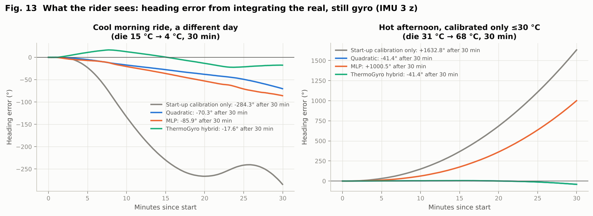

# ThermoGyro

**Machine-learning temperature-drift compensation for the MPU-6050 gyroscope, trained and tested on real environmental-chamber data.**

Course project, *Introduction to AI & Machine Learning for Applications in Mechanical Engineering*, NIT Tiruchirappalli · Vaibhav Chandhok · October 2026



## The problem

My first-year project, a smart dockless bicycle (ESP32 + GPS + MPU-6050), uses the MPU-6050 gyro to know which way the bike is pointing. The same bike may be unlocked on a cool morning and again after standing in the afternoon sun. A gyro's zero point (its *bias*) moves with the chip's temperature, so a bike that is not moving at all slowly "turns" in software. Typical Arduino code calibrates the bias once at room temperature and never again.

The real data used here shows how large that is. Across −18 °C to 72 °C the z-gyro bias of one chip moved by **3.8 °/s**. Integrated over a 30-minute hot ride (die 31 → 68 °C), a still chip with only start-up calibration accumulated **1,633° of false heading**, about four and a half full turns. With ThermoGyro the same recording gives **−41°**.

## What is in this repository

| Path | Content |
|---|---|
| `data/raw/` | The public Cranfield University MPU-6050 chamber dataset (CC BY 4.0), unmodified. See `data/README.md`. |
| `src/data_loader.py` | Reads the four Excel files into one tidy table (gyro converted to °/s). |
| `src/preprocess.py` | Glitch removal (robust rolling-median test), 10-s averaging, heating-rate feature dT/dt. |
| `src/models.py` | All models written from scratch in NumPy: single-point calibration, polynomial/ridge regression via the normal equation, batch gradient descent, an MLP with hand-written backpropagation and Adam, and the ThermoGyro hybrid. |
| `src/experiments.py` | Every study in the report → `results/*.csv|json` and `figures/*.png`. |
| `src/export_app.py` | Trains the deployable models and exports weights + real data excerpts for the web app. |
| `tests/` | Backprop gradient check against finite differences, normal-equation and gradient-descent checks, JS-vs-Python parity check. |
| `docs/` | The web app (GitHub Pages ready): bias explorer, ride playback on real data, and an in-browser calibrator for your own chip that writes ESP32 code. |
| `web/thermogyro.html` | Source of the web app; `tools/build_pages.py` builds `docs/index.html` from it. |
| `firmware/` | ESP32 logger and compensation sketches (compile-checked, **not yet run on hardware**). |
| `examples/` | A real 1 Hz log (IMU 1, cycles-with-dwells run) to try the calibrator with. |
| `report/` | The project report (PDF). |

## Method in one paragraph

All sensors in the dataset were held still, so every gyro sample is bias + noise. After removing 82 logging glitches (out of 189,402 samples) and averaging to 10 s, I modelled bias as a function of die temperature *T* and heating rate *dT/dt* with: single-point calibration (the hobby baseline), linear and quadratic regression (normal equation), polynomials up to degree 10 with ridge and lasso, gradient descent, an MLP, and the **ThermoGyro hybrid**: a quadratic physics backbone plus a small tanh MLP that learns only the residual (mostly heating/cooling hysteresis), with a *range guard* that switches the MLP off outside the calibrated temperatures. At every power-on the device measures its bias for a few still seconds (*start-up anchoring*) and the model supplies only the change with temperature.

## Results (real data, RMSE in °/s; full tables in `results/`)

| Test | What it means for a rider | Finding |
|---|---|---|
| **Inside the calibrated range** (5-fold blocked CV, thermal sweep, 9 chip-axes) | calibrated over the temperatures you ride in | Hybrid beats the quadratic on **9/9** chip-axes (median 1.75× lower error) and single-point calibration by a median **14×**. |
| **Calibrated ≤30 °C, used above 30 °C** | calibrated in winter, ridden in summer | Quadratic beats single-point calibration on **9/9** (median 2.7×). The MLP alone fails here (it flat-lines outside its data), and degree-9 polynomials reach errors of 41–16,792 °/s. The range-guarded hybrid falls back to the quadratic. |
| **A different day** (trained on the sweep, tested on two other runs) | the next power-up | The bias shifts by up to 2.7 °/s between runs (power-ups) at the same temperature; start-up anchoring halves the quadratic's median error (0.23 → 0.11). The learned shape helps on strongly drifting axes but not on weakly drifting ones; the hybrid's in-range advantage does not reliably carry across days. |
| **A different chip** | buying a new sensor | Using another chip's model gives errors of 1.3–10.5 °/s. Every chip needs its own calibration, which is why the app includes a calibrator. |

Other studies: bias–variance degree sweep, ridge/lasso, gradient descent stability (α < 2/λ_max, condition number 1,950 unscaled vs 1 scaled), MLP architecture and dying-ReLU check, learning curve, humidity (confounded with time in this dataset, so no humidity effect can be claimed), data-quality impact of real glitches, and ±2·RMSE uncertainty bands with measured coverage.

## Run it

```bash
pip install -r requirements.txt
./run_all.sh                       # ~3 minutes; regenerates every result, figure and app model
cd docs && python -m http.server   # open http://localhost:8000
```

To publish the app: in the repository's settings, enable GitHub Pages from the `docs/` folder.

## Honest limits

* Three chips from one dataset; all sensors static. Results describe these chips, not every MPU-6050.
* No humidity effect can be claimed: in the humidity run, RH falls almost perfectly with time (r = −0.999).
* Extrapolation remains fragile: dropping one-seventh of the calibration blocks changed the quadratic's hot-zone error for IMU 1 x from 0.22 to 0.84 °/s.
* The firmware was compile-checked only; it has not been run on a board.

## Credits

Data: D. Maton, J. Economou, D. Galvão Wall, I. Khan, R. Cooper, *Low-cost IMU Sensor Temperature Humidity Zero Bias Data*, Cranfield University, 2024, DOI [10.17862/cranfield.rd.24291112](https://doi.org/10.17862/cranfield.rd.24291112), CC BY 4.0. Chart.js 4.4.1 (MIT) is bundled in `docs/vendor/`. Code: MIT licence.
